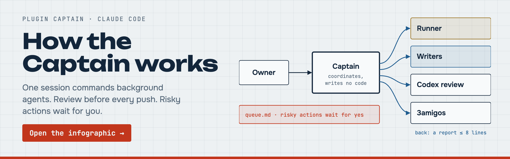

# ai-marketplace-mentorano

A Claude Code plugin marketplace for tools that read the state of a repository —
what work is in flight, who moved it, how far each piece got — and keep its
code clean.

## Install

```bash
/plugin marketplace add mentorano/ai-marketplace-mentorano
/plugin install 3amigos@ai-marketplace-mentorano
/plugin install branch-board@ai-marketplace-mentorano
/plugin install captain@ai-marketplace-mentorano
/plugin install cc-safety-net@ai-marketplace-mentorano
/plugin install clean-code@ai-marketplace-mentorano
/plugin install project-memory@ai-marketplace-mentorano
/plugin install utils@ai-marketplace-mentorano
```

To work on the marketplace itself, point Claude Code at a local clone instead:

```bash
/plugin marketplace add <path-to-your-clone>
```

## Plugins

### 3amigos

A one-round panel of three independent experts for brainstorming and triage,
chosen from a pool of four: Codex, Gemini, a Claude Opus agent and a Claude Fable
agent (the default panel is Codex, Gemini and Fable). Each answers the same task as
JSON, then one non-voting Opus synthesizer merges the answers by majority and
agreement, with authorship and level of agreement kept. A voter that fails is
replaced by a Fable stand-in with its own framing. `scripts/panel.py` runs the
external voters in parallel: Codex (one retry, no retry after a timeout) and Gemini
(`agy` first, then a Vertex AI or API key fallback; failures are data). The
`3amigos:3amigos-setup` skill writes the panel and Gemini config. `scripts/tally.py`
tallies per-item verdicts as agree / majority / split. Everything the panel
produces is a proposal; it never deletes or overwrites anything. Not for code
review. Invoke it as `/3amigos:3amigos`. See
[`plugins/3amigos/skills/3amigos/SKILL.md`](plugins/3amigos/skills/3amigos/SKILL.md).

Since 0.6.0 Gemini is a voter, the default panel is Codex, Gemini and Fable, and the
caller chooses the panel. The panel comes from, in this order: the run's `--panel`, the
project config `<main checkout>/.claude/3amigos.local.json`, the user config
`~/.claude/3amigos/config.json`, the default. `panel.py --show-config` prints the effective
panel and Gemini settings as one JSON line, never a key or a token, and a config error stops
the run before any voter starts. REFERENCE.md "Choosing the panel" says which voters fit which
task. An external voter gets 600 s by default (`--deadline`); Gemini walks `agy` and its
fallback, with the preferred and then the second model, within that one deadline.
`/3amigos:3amigos-setup` detects `agy`, a working `gcloud` login and a Gemini key variable,
asks for the default panel and the Gemini fallback (`vertex`, `key` or `none`), writes one or
both configs and never a secret, then tests each chosen scope with one tiny panel run, in which
Gemini may make up to two paid fallback requests.

Since 0.6.2 the setup finds what the project already uses for Gemini with one script,
`scripts/project_scan.py`: `git grep` over the text files and a search of the `.env*` files,
binary files skipped, so a repository with many gigabytes of media takes seconds, and no
`.env` file name appears in a shell command for a safety hook to block. It also finds a
Vertex project id that code passes with no env assignment, offers the `gcloud` default
project, and the setup report says which Gemini model answered and through which backend
(`Gemini answers: <model> through <backend>`).

Since 0.7.0 the voters may search the web: `panel.py` starts Codex with `--search`, and the
`agy` prompt no longer forbids it. The Gemini fallback (Vertex or key) sends no search tool,
and `--deadline` still caps the external voters (Codex and Gemini).

### branch-board

Builds a live status page for a repository's recent branches: what exists, who
moved it, how far it got, what it touches, and what its own plan documents say
the goal is.

It exists because `git branch -a` is a list of names with no state attached, so
nobody reads it. The skill turns the last N days of branch activity into one
page, and every number on that page comes from a command the page names.

The board is a three-stage pipeline, and **`BOARD.md` is the source of truth**.
Git is measured once, the markdown carries the result, and the page is rendered
from the markdown:

```
git ──collect.py──▶ board.json ──board.py──▶ BOARD.md ──render.py──▶ board.html ──▶ Artifact
      measurement                 skeleton      ▲ you write the prose here
```

```bash
S=plugins/branch-board/skills/branch-board
python3 $S/collect.py <repo> --days 7 > board.json   # git and gh -> measurements
python3 $S/board.py board.json --out BOARD.md        # measurements -> markdown
#   fill in one TODO per branch — the only place judgement is allowed
python3 $S/render.py BOARD.md --out board.html       # markdown -> page
```

Then publish `board.html` with the Artifact tool. Re-publishing the same file
path replaces the page at the same URL, so a link a colleague bookmarked keeps
working as the board is re-run. Commit `BOARD.md`: its diff between two runs is
a readable record of what moved.

The page and the `BOARD.md` skeleton are in English. The plan reader
understands goal and task headings in Bulgarian and English.

Since 0.1.1 the prose is self-reviewed with `utils:self-review` against the
measured values before the board goes out: every state, count and date in a
sentence equals its field, inference is marked as inference, and every `TODO:`
is answered or left on purpose.

What the collector guarantees, in one line each:

- It fetches with `--prune`, and says in `meta.pruned` when it could not —
  a branch deleted on the remote otherwise survives as a live-looking ref.
- "Landed" comes from `merge-base --is-ancestor` **or** a merged PR, never from
  how complete the diff looks. `landed_by` names which one.
- A squash merge rewrites the commits, so `--is-ancestor` alone reports landed
  work as open. Only the merged PR catches it, and without `gh` the page must
  say it cannot tell.
- The window keeps a branch whose open PR moved inside it, even when its tip
  did not. `in_window_by` says which put it there.
- Plan documents are read from the branch itself with `git show`, and each is
  marked `plan` or `incidental` so the page can say when a branch carries no
  plan of its own.
- The plan's title, goal, checkboxes, numbered tasks and flags measure the
  document, not the code, and every one of them ignores whatever is inside a
  fenced code block — including a block closed by a longer fence than it opened.
- `gh` that fails is declared, not silently read as "no PR", and a full open-PR
  listing says it may be truncated. Numbers are never guessed into place.
- An unresolvable base is fatal. An empty page is a bug, not a finding.

Full contract, and the rules that keep the output honest, in
[`plugins/branch-board/skills/branch-board/SKILL.md`](plugins/branch-board/skills/branch-board/SKILL.md).

### captain

<a href="https://mentorano.github.io/ai-marketplace-mentorano/captain/">
  <picture>
    <source media="(prefers-color-scheme: dark)" srcset="site/captain/banner-en-dark.png">
    
  </picture>
</a>

A time-boxed coordinator for coding runs, shared as a team plugin. One main
Claude Code session coordinates and does only the light work (reads, git
inspection, notes and docs): it splits the work, launches background
subagents in their own git worktrees, routes every commit through a review
first (Codex by default, Opus as the fallback), keeps time with a 15-minute
health check, and queues destructive or outward actions — shared databases,
deploys, publishing, GitHub writes — for the user at the end of the box. Code
and functionality only; no devops, production or external writes, and no pull
requests unless the user asks. The one exception is a dev or test target the
user listed (`dev_targets` in the config, confirmed once): it runs after review,
with the real endpoint checked first. Agents report once, in at most 8 lines;
the 15-minute health check prints one status line; every status, park and end
report ends with a `Remaining:` list from the run state. Since 0.19.0 the status
line also shows the share of tasks done (`7 of 12 tasks done (58%)`), and
each `Remaining:` line says whether it waits on the user (`[waits on you]`) or is only
information (`[info]`). A run that fixes a given
list (`mode: fix-all`) uses TODO only as the last resort. Since 0.17.0 the run plans
the most parallel work after the spec (`reference/parallel.md`), writers run no tests and a
runner tests each service or module group once after its last merge, the time box is
informative (hard end at +30%, up to three more +30% while work is open, plus the length of a
network outage; `strict` keeps an exact end for timed creative tasks), a TODO entry needs
evidence and one concrete reason, and the `experiment` writer duel is gone. Since 0.12.0 a reviewed agent branch is merged at once,
without asking, into the run's feature branch and into a base branch the user
confirmed by typing `/captain base <branch>` (never `main`, `master` or the default branch, which
stay gated by `/captain merge <branch>`). In conversation and in status lines the
coordinator is called the Captain („Капитана“, address form „Капитане“, also
„Капитан Петров“) — all these names mean this role.

It exists because the same failures kept coming back in long coordinated runs:
the main session doing real work itself, reviews after the fact, two agents
without worktrees colliding on `main`, idle hours after a usage limit had
already reset, and nobody tracking the elapsed time. Each rule in the skill
carries a one-line why.

Setup: before the first run, run `/captain:captain-setup` once. It asks how
you want notifications — `msg-notify`, your own command, or none — your
quiet hours, and whether to notify only when you are away from the computer
(no keyboard, mouse or trackpad input for 15 minutes after the event, read on
macOS), and detects which of `codex` and `agy` are installed. It
writes `~/.claude/captain/config.json` and the wrapper
`~/.claude/captain/notify.sh`. Without Codex the reviewer is Opus.

The skill starts only when you name it (argument hint `[<timebox>] [away]`).
Model invocation stays allowed, so asking Claude to "use the captain skill" or
"start the captain for 30 minutes" works as well as the slash command; the
description tells Claude never to start a run on its own. Invoke it
as `/captain:captain [<timebox>] [away]`, e.g. `/captain:captain 30m` or
`/captain:captain 1h away`; the arguments are order-free. Plain `/captain`
also works as long as no other command uses that name (see the Claude Code
docs on plugin skills). Only if it clashes, symlink the skill as a fallback:
`ln -s <clone>/plugins/captain/skills/captain ~/.claude/skills/captain`.

`SKILL.md` stays within a budget: at most 500 lines and roughly 23,500
characters, after the official guidance for skills (under 500 lines, under
about 5k tokens). The rules stay short there; their mechanics — CLI flags,
prompt templates, consensus, timers and the health check, the queue — live in
`reference/*.md`, so a flag change edits one place.

The plugin ships four agent types: `captain:worker` (Opus, effort medium, the
default for writers, reviewers and voters), `captain:deep` (Opus, effort
high, only for very complex reviews, critical actions and full consensus),
`captain:light-coder` (Sonnet, effort high, a coding task that passes the light test,
`reference/light-test.md`) and `captain:runner` (Sonnet, effort medium: bootstrap, builds,
group tests, scripts, the Codex review runner, cleanup).

Captain mode lasts for the whole session, not only the time box: once a run
starts, later fixes in the same session still go to agents. `/captain off`
ends it. The plugin hook `hooks/guard.py` enforces this: while the mode is
on, it denies every main-session call that is agent work (code edits,
commits, builds, tests, scripts, Codex) and says to delegate it — the same
check `scripts/audit-main.py` runs after a run.
Subagents are never blocked. A writer holds one task at a time; when it
finishes, `scripts/agent-context.py` measures its context, and at 30% of the
window or more (20% before 0.18.0) a fresh writer takes the next task.

Since 0.7.0 the captain hands the run to a fresh session at a task or merge
boundary once its own context reaches `context_threshold` (default 250k, set in
`/captain:captain-setup`; since 0.9.0 also a percentage such as `45%` of the model's context
window, which Claude Code reports per model): it writes a self-contained handoff and a kickoff, you
type `/clear`, then `/captain resume` (R21, `reference/handoff.md`). The plugin
hooks `handoff_at_boundary.py` and `kickoff_on_clear.py` do the measuring and the
injection. Since 0.32.0 the coord plugin is gone and captain no longer defers to its global
hooks: if you once ran coord's `install-hooks.sh`, delete `kickoff-on-clear.py` and
`handoff-at-boundary.py` from `~/.claude/hooks/` and their entries from `~/.claude/settings.json`,
or both kickoff hooks race for the same file after `/clear`.

Since 0.8.0 the successor can start in a new terminal tab instead of `/clear` (cmux since 0.11.0):
`/captain:captain-setup` asks for `successor_terminal`, `supacode`, `cmux` or `none`. Without the
key, a session that runs in Supacode gets a Supacode tab, one that runs in cmux a cmux tab, and any
other gets `/clear`; it is a per-user
setting, since another laptop may use another terminal. A `captain:runner` runs
`scripts/successor-tab.py`, since 0.15.0 a thin wrapper around `utils:new-session-tab` (utils
0.3.0 or newer must be installed; without it the script prints the install command and the
handoff falls back to `/clear`): it opens the tab always with `-w` for the session's worktree and
starts `claude -n <name>` in the same permission mode, with the prompt in a file (Supacode's
`-i` garbles non-ASCII text). The new session sends `STARTED` with its directory; the old one
checks it, answers `ACK` with any owner words since the handoff, and only then stops. Other
terminals would be new values.

Since 0.28.0 every author self-reviews its output before anyone acts on it (SV1): the skill
`utils:self-review` (utils 0.8.0 or newer; without it the same steps by hand), in the same
context, with no subagent and no test run. An agent does it before every commit and before its
report, whose item 2 carries the `self-review:` result. The main session does it for what it
writes itself: the handoff first (against `decisions.md`, `run.md` and `queue.md`, with a
`Self-review (SV1):` line the successor looks for), the plan split, the UI use-case list, a
panel's task file. It never counts as a review at the push gate; the review by a fresh agent
stays.

Since 0.29.0 full consensus runs on the effective 3amigos panel, with Gemini as a voter
(`reference/consensus.md`). The coordinator classes each decision itself and passes the panel
with `--panel`: technical decisions (design, architecture, spec critique, code triage) go to
Opus, Codex and Gemini; product, scope, UX, naming and creative ones to Codex, Gemini and
Fable; anything else to the 3amigos "Choosing the panel" table or the default. The run's choice
wins over the project and user configs, and `decisions.md` records it as
`panel: <class> — <panel>`. Each external voter gets its own runner, so a missing voter's Fable
stand-in starts as soon as that voter ends; the external voters get min(600 s, park − 5 min),
600 s with no box. Only Codex is ever dropped (off in the config or at its usage limit); an
`agy` usage limit seen once adds `--no-agy` to every later panel of the run, and Gemini then
runs on its fallback.

Since 0.30.0 visible work the owner must see — screens, dialogs, texts, several items at once —
goes to a local review page instead of the chat (R23, `reference/review-page.md`). A runner
takes the screenshots at the owner's sizes, builds the page from a `sections.json` with
`build.py` and serves it on 127.0.0.1 with `serve.py` (standard library only;
`--lan` adds a link with a random key for the owner's phone on the same network);
the owner comments per section (`ok`, `change`, `question`) into `comments.jsonl` in the run
directory, and a worker triages those comments for the coordinator, who turns them into fixes
and answers. Yes/no and permission questions stay in the chat. The page is never published or
committed. Since 0.31.0 the page comes from `utils:review-page` (utils 0.9.0); without it the
owner gets one chat line per item with its screenshot paths.

Since 0.33.0 no prompt forbids the web. Codex reviews, consults and votes run as
`codex --search exec …` and may check claims about external platforms, libraries and tools
against their official docs, with the source URL; agy and the Fable and Opus agents get the same
line. The `timeout` of each call still caps it, and a timeout retry keeps web search on.

Since 0.10.0 the captain runs the merges itself: `git merge --no-ff` of a reviewed agent branch,
`git merge --abort`, and `git commit --no-edit` after an agent resolved the conflicts. The
auto-mode classifier denied agents' reviewed merges too often. `hooks/guard.py` checks these
live: one command per call, never a detached HEAD or `main`, `master` or the origin default
branch. A merge or push into one of those waits for you to type `/captain merge <branch>`; that
grant lasts for the run, in that repository and for that branch (until `/captain off`, a new
start, a new grant, the end report or 12 hours), and a Skill call made by the model never
grants it; a handoff successor takes over the live grant of its run.

Review rounds end on triage, not on a clean verdict. The writer classes each
finding FIX NOW, ACCEPT or TODO from facts (reachable in normal use, origin,
impact); the coordinator applies a round threshold, so rounds 2+ block only on
reachable real defects. A mechanism that draws findings in two rounds becomes
a question for the owner, and a decisions register stops re-raised findings.
Details: `reference/triage.md`.

Since 0.16.0 the captain keeps the lessons its workers paid for, when the project-memory plugin
is installed and the run checkout has a working `.agent-memory/` layout. A worker writes each
lesson as a draft file in the run directory and names it in a `Memory candidate:` line; the
coordinator reviews the drafts against the project-memory write trigger, writes the kept ones
into `.agent-memory/` itself, one Opus agent revalidates them, and a runner checks them with
`memory.py` and commits them alone. Without the plugin or without `.agent-memory/` the captain
behaves exactly as before.

See
[`plugins/captain/skills/captain/SKILL.md`](plugins/captain/skills/captain/SKILL.md).

### cc-safety-net

Mentorano's fork of
[kenryu42/cc-safety-net](https://github.com/kenryu42/cc-safety-net) (MIT), at
[mentorano/cc-safety-net](https://github.com/mentorano/cc-safety-net). It is a
PreToolUse hook that blocks destructive commands and access to secret files. The
fork changes three things, each as its own commit on the fork's `main`: a
quoted heredoc written through `command cat` or `env cat` stays text, so a
path it only mentions is not read as secret access; `git diff`, `log`, `show`,
`status` and `blame` may name the policy file as a pathspec; and in a
subdirectory or a linked worktree the project policy is read from the nearest
`.cc-safety-net/` up to the repository root. Install it instead of
`cc-safety-net@cc-marketplace`, not next to it. The entry is pinned to a
commit `sha` on the fork's `main`. The fork does not update itself: to take a
new upstream release, merge the author's release into the fork's `main` with a
merge commit, run `bun run check`, push, and move the `sha`. Never rebase or
force-push the fork's `main`; a fresh install can no longer fetch a pinned
commit that no branch holds.

### clean-code

Five skills and two scripts. The skills carry Clean Code and Clean
Architecture rules shaped for Python / FastAPI and TypeScript / React;
`measure.py` measures function length, complexity, parameters, nesting and
file size, also for plain JavaScript files and the inline scripts of HTML
pages, `boundaries.py` measures the import graph — dependency direction,
cycles between modules, framework types in the domain, SQL in handlers — and
the agent runs them before and after every change so the verdict comes from
a command. With `--compare` both scripts measure the same files a second
time at the merge-base and give a verdict per function, file and boundary
rule, so a trade that the totals hide still shows. An audit mode runs both
over a whole tree and keeps shape and boundaries as two lists. See
`plugins/clean-code/README.md` for the thresholds, the rules and a
sample run. The `clean-code-logging` skill fixes Python JSON/GCP
logs and TypeScript browser console logs, with named trailing values ordered
by stability. Run `/clean-code:clean-code-logging`; add `audit` for a report.

The `architecture-fundamentals` skill adds system-level architecture decisions
and reviews based on Richards and Ford's *Fundamentals of Software
Architecture*, second edition. It covers business drivers, data ownership,
runtime coupling, architecture styles, risks, decision records, and fitness
functions. Run `/clean-code:architecture-fundamentals` with the system or
decision to review. Ordinary refactoring stays in clean-code; source metrics
do not prove operational fitness.

Since 0.7.1 an ADR or an architecture review is self-reviewed with
`utils:self-review` before it is handed over, and TypeScript syntax in a
JavaScript file (a type annotation, `private`) is an error: such a `.js` file
is a broken run and such an inline HTML script is listed as `UNPARSED`; two
inline scripts on one HTML line count that line once.

### project-memory

Committed project memory: durable rules about the code — traps, verification
recipes, unstated invariants, settled decisions — kept in `.agent-memory/` at the
repo root, one topic per markdown file, committed and reviewed with the code. A
committed relative symlink `.claude/rules/project-memory -> ../../.agent-memory`
lets Claude Code load them as native rules: a file without `paths` at session
start, a file with `paths` when a matching file is touched. Writes go to
`.agent-memory/`, outside the protected `.claude/` directory, so they need no
protected-path prompt. Only the main session writes memory, with no limit on
how many files a session writes; subagents end their reports with `Memory candidate:` lines. The write
rules live in the committed `.agent-memory/README.md`, so teammates without the
plugin get them too.

`/project-memory:memory-init` creates the layout (idempotent, never commits). A
`SessionStart` hook (`startup` only) stays silent unless the layout does not
fully load or the file-state health is `due` / `overdue`.
`/project-memory:memory-defrag` dispatches one general-purpose subagent that
merges, splits and trims the files, prunes only the files it emptied, and shows
the full diff for review. Since 0.1.2 the defragmenter self-reviews before its
report: every rule a removed line carried is in a file that stays or is named
under **Removed**. Review `.agent-memory/` like CLAUDE.md and add it to
CODEOWNERS. The defragment prompt, write trigger and thresholds are ported from
worca-cc (MIT). See
[`plugins/project-memory/README.md`](plugins/project-memory/README.md).

### utils

Small helpers for working with Claude Code.

- `bg-claude-rc` starts a new, empty Claude Code session in the background, in
  the git root of the current repository, with Remote Control on. The session
  is named `<repo-slug>-<YYYYMMDD>-rc<N>`, where N is the first number not yet
  taken by a live session or by a transcript from today, and the script prints
  the session link so the work can go on from a phone or the web. Needs `jq`.
  See [`plugins/utils/skills/bg-claude-rc/SKILL.md`](plugins/utils/skills/bg-claude-rc/SKILL.md).
- `new-session-tab` (since 0.3.0) opens a new Supacode or cmux tab with a new
  Claude Code session that starts from a prompt file, and covers "write a
  handover prompt and start a new session": the prompt goes to
  `./tmp/handover-<topic>-<date>.md`, then the tab opens. The tab command is
  ASCII-only with the prompt read by `"$(cat file)"`, a Supacode tab always
  opens with `-w` for the worktree, and `TAB-OK` comes only after a shell ran
  in the tab; a tab that ran nothing is closed and reported as `TAB-DEAD`.
  `--version` prints the plugin version. The captain successor tab uses it.
  Since 0.5.0 the tab reads a copy of the prompt whose first step asks the new
  session to send `STARTED <name> pwd=<dir>` to the session that opened it
  (`--reply-to`, else that session's own name from `claude agents --json`),
  and the skill waits up to three minutes for that message, also after a
  hand-pasted fallback. A slash-command prompt runs unwrapped. Since 0.8.0
  the handover prompt is self-reviewed with `utils:self-review` before the
  tab opens.
  See [`plugins/utils/skills/new-session-tab/SKILL.md`](plugins/utils/skills/new-session-tab/SKILL.md).
- `one-by-one` (since 0.4.0) runs a one-by-one pass over review findings or
  open points: one item at a time, a question for every point that changes
  behaviour, and a new choice found while fixing becomes the next question
  instead of an "open points" list in the final report. Only a question the
  user cannot answer or explicitly defers stays in the report, marked as
  deferred.
  See [`plugins/utils/skills/one-by-one/SKILL.md`](plugins/utils/skills/one-by-one/SKILL.md).
- `review-page` (since 0.9.0) builds a local page for the owner when there
  are two or more visible items at once (screens, dialogs, user-facing texts,
  a visual before/after), or when the owner asks for one: one section per item
  with its screenshots, served on 127.0.0.1 and, with `--lan`, on the local
  network for the owner's phone. The owner comments per section (`ok`,
  `change`, `question`) and says "done"; the session reads the comments with
  `comments.py --since <n>` and turns them into fixes and answers. Yes/no and
  permission questions stay in the chat, `ok` never grants a merge or a push,
  the stop command is always given, and the page is never published. A
  background agent starts one only when its prompt says so.
  See [`plugins/utils/skills/review-page/SKILL.md`](plugins/utils/skills/review-page/SKILL.md).
- `self-review` (since 0.8.0) is one pass over an output you just wrote, in the
  same context, before anyone acts on it: code (a diff), a fix of review
  findings, a spec, a plan, a doc, a handoff or handover prompt. It reads the
  whole output back against its sources, collects findings, revalidates each
  one against the source, fixes only the confirmed ones and reports every
  finding with its outcome and a `self-review:` result line. It launches no
  subagent and runs no test or build, and it never counts as a review: the
  review by a fresh agent still follows. The captain rule SV1 and the
  `new-session-tab` handover call it.
  See [`plugins/utils/skills/self-review/SKILL.md`](plugins/utils/skills/self-review/SKILL.md).
- `share-artifact` (since 0.6.0) shares one or more claude.ai artifacts with
  the people the user names. No tool can do it, so a background subagent opens
  each artifact's Share dialog in the user's own Chrome (Claude in Chrome, in a
  new tab it closes at the end), invites only the addresses not yet invited, at
  Commenter unless the user asks for Viewer or Editor, and reports per artifact
  who was already there, who was added, General access and when the invites
  expire. It never makes an artifact public, changes another setting or removes
  anyone; a dry-run only reads who has access.
  See [`plugins/utils/skills/share-artifact/SKILL.md`](plugins/utils/skills/share-artifact/SKILL.md).

## Tests

```bash
./run-tests.sh
```

One suite per plugin area, all listed in `run-tests.sh`. The collector suite builds real throwaway repositories — squash
merges, refs deleted behind the clone's back, plans full of fenced blocks — and
asserts on the JSON. The pipeline suite asserts that the markdown really is the
source: a value edited in `BOARD.md` reaches the page, and the renderer never
reaches back into the JSON. The measure and boundaries suites measure fixtures
with known numbers and scratch packages that each break one boundary. The
revisions suite builds scratch repositories and checks `--at` and every
`--compare` verdict of both scripts. The skills suite checks every `SKILL.md`
frontmatter and the two manifests. The bg-claude-rc suite runs
`start.sh` against a stub `claude` and a temporary `HOME`, so it starts nothing.
The new-session-tab suite runs `new-session-tab.py` against stub `supacode`,
`cmux` and `claude` binaries, so it opens no tab.
The captain suite checks the skill's text — every rule
R1–R23 with its `Why:` line, the budget of `SKILL.md`, the required CLI
strings and forbidden flags in the reference files, the web-search line in every
review prompt — and runs `audit-main.py` over small synthetic transcripts.
Those checks prove the text is there, not that the model follows it.

The TypeScript tests need `node` and the `typescript` package. They look for
it at `CLEAN_CODE_TS_PACKAGE`, then at `node_modules/typescript` in the repo
root, and skip with one line when neither is there. The root `package.json`
pins it as a test-only dependency: `npm ci` in the repo root installs it, and
`run-tests.sh` runs `npm ci` once by itself when it is missing. TypeScript 7
ships without the JavaScript compiler API that `measure-ts.mjs` loads, so the
pin stays on 5.x.

```bash
BB_COLLECT=<path-to-another-collect.py> ./run-tests.sh
```

runs the same suite against another copy of the collector. That is how the suite
was shown to be red before the fixes it pins down. A test that has never failed
proves nothing.

## Layout

```
.claude-plugin/marketplace.json    the marketplace manifest
plugins/<name>/
  .claude-plugin/plugin.json       the plugin manifest
  skills/<name>/SKILL.md           the skill itself
  skills/<name>/*.py               scripts the skill runs
run-tests.sh                       runs every suite in tests/
tests/                             fixtures build real git repos; stubs fake `gh`
```

## License

MIT, copyright Mentorano Ltd. See [`LICENSE`](LICENSE).
